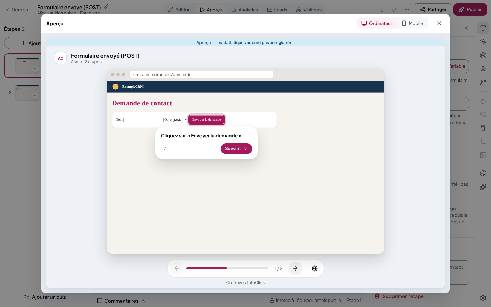
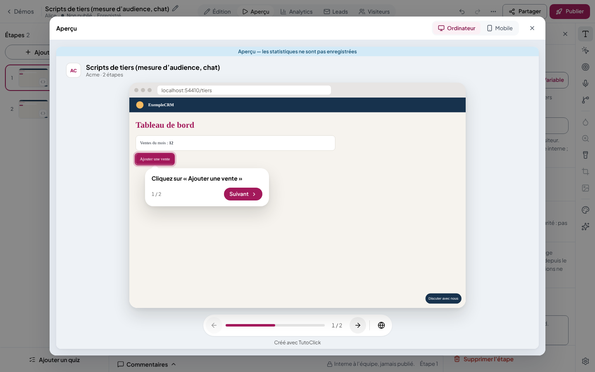
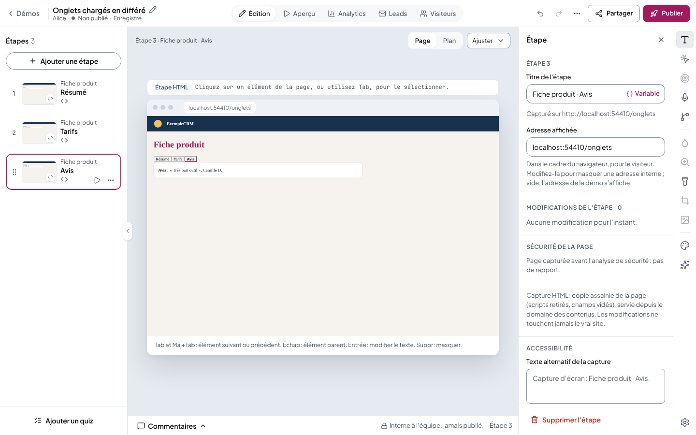
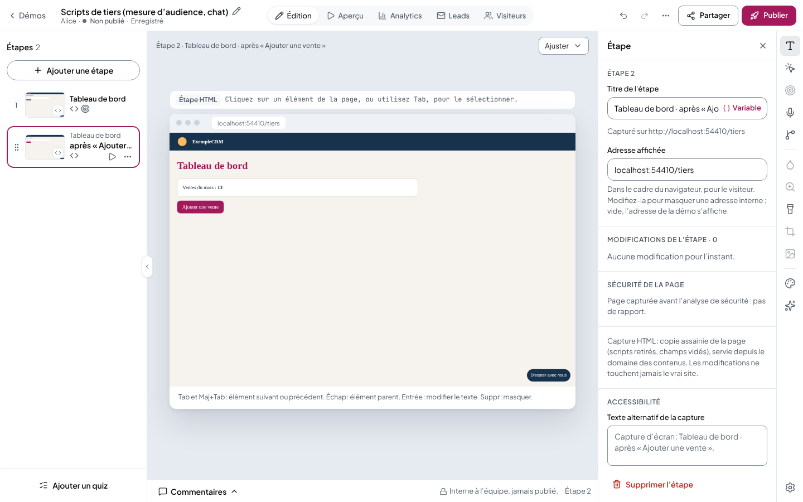
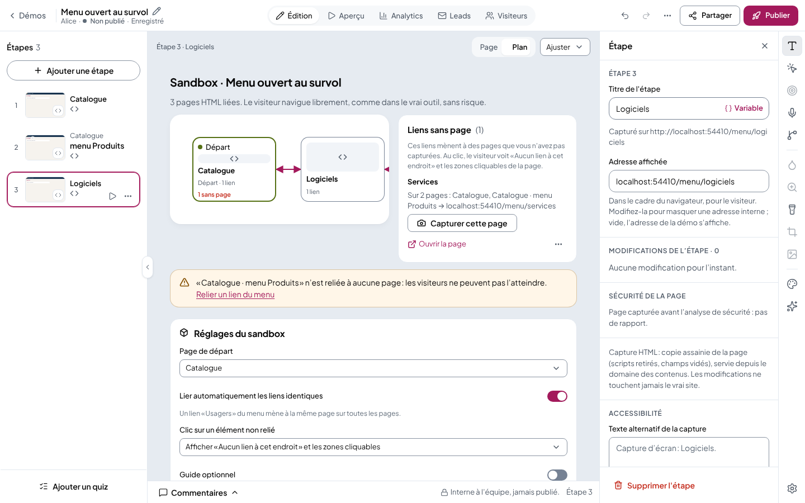
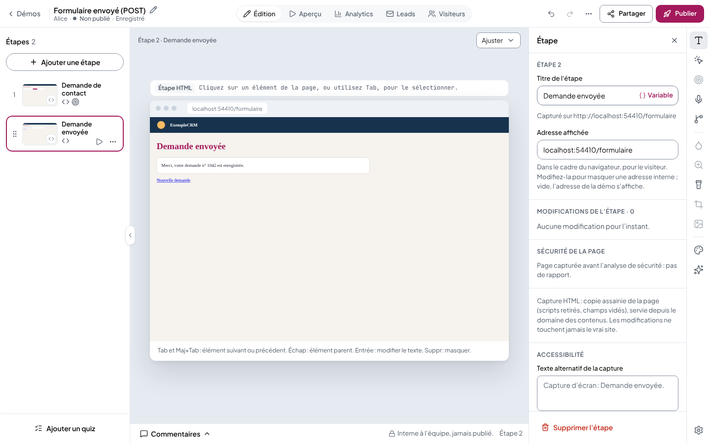
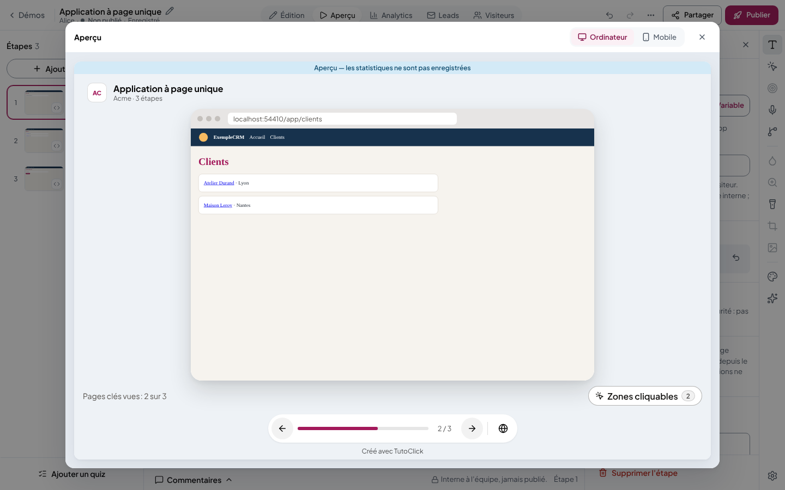

# L60 lot B, correctif de la recette ROUGE : rapport « à la place de l’utilisateur »

Réponse à `docs/ux/recettes/l60-lot-b/rapport.md` (branche UX, e78e74c). Recette refaite pour de vrai :
- extension construite (`WXT_E2E=1`) et chargée dans Chromium ;
- les 7 sites fictifs du banc (`apps/extension/e2e/banc/`), aucune adresse réelle ;
- envoi depuis « Vérifier avant l’envoi » ;
- ouverture dans l’app de ce que l’extension a envoyé, sans rien retoucher : liste des étapes,
  panneau de l’étape, plan du Sandbox, aperçu du lecteur.

Parcours rejouable : `node e2e/banc/bout-en-bout.cjs` (il tourne en intégration continue). Résultat :
**150 contrôles sur 150** (111 avant le correctif). Détail dans [controles.md](controles.md).

Limite connue, inchangée : le faux serveur ne rejoue pas l’assainissement de `html-ingest`, donc
« Sécurité de la page » affiche « pas de rapport ».

## 1. La démo guidée HTML guide (ROUGE §2.1)

Chaque clic capturé entre deux pages devient une bulle posée sur l’élément cliqué :
- la bulle s’intitule « Cliquez sur « Envoyer la demande » » ;
- elle est ancrée par le sélecteur de l’élément, avec la place mesurée au clic en secours.

Dans le lecteur, l’élément est entouré, et un clic dessus mène à l’étape suivante. L’encart « Aucune
zone cliquable sur cette étape » ne s’affiche plus sous une telle bulle. Le Sandbox garde son lien,
comme avant.

Le même écran sur « Scripts de tiers ». Après le clic, l’aperçu passe bien à l’étape 2 : la bulle
de l’étape 1 disparaît, alors que les deux pages portent le même titre.

Contrôles ajoutés à `bout-en-bout` :
- la bulle est envoyée, avec le sélecteur et le libellé ;
- dans l’aperçu, on voit la bulle et l’anneau, sans l’encart « Aucune zone » ;
- un clic sur l’élément fait changer d’étape.

## 2. On reconnaît les étapes dans la liste (ROUGE §2.2, gêne 3)

- **Vignette** : un rendu réduit de la page copiée, dans une iframe sandbox vide, sans aucun script.
  La pastille « <> » est dans le coin.
- **Nom** : deux lignes au plus, jamais coupé net, et le nom complet en infobulle.
  - « Écran · Partie » : l’écran sur la 1re ligne, en 12 px gris ; la partie sur la 2e, en 14 px.
  - Les actions « Lire » et « … » sont descendues sur la ligne des icônes, pour que le nom garde
    toute la largeur, même sur l’étape en cours. Avant, il n’avait que 55 px, d’où « Catalogu ».

## 3. Noms distincts (ROUGE §2.3, gêne 1)

- Menu ouvert au moment de la copie : « Catalogue · menu Produits ».
- Page qui reprend le nom d’une page déjà envoyée : « Tableau de bord · après « Ajouter une vente » ».
- Sinon un numéro : « Catalogue (2) ».

Le nom reste modifiable dans l’éditeur. `bout-en-bout` vérifie que les noms sont distincts sur les
7 parcours.

## 4. Liens sans page regroupés (gêne 2)

- Une ligne par destination, avec « Sur 2 pages : Catalogue, Catalogue · menu Produits ».
- Une seule action « Capturer cette page ».
- « Relier à une page » et « Laisser le message » valent pour toutes les pages qui portent le lien.
- Le compteur et la description du plan comptent les destinations.

## 5. Adresse affichée (gêne 4)

- Le cadre du lecteur affiche le domaine et le chemin de la page capturée, en lecture seule
  (« localhost:54410/formulaire »).
- Le Sandbox prend le même cadre, et l’adresse change avec la page (« localhost:54410/app/clients »).
- Le panneau de l’étape a un champ **Adresse affichée**, prérempli et modifiable. Le parcours du
  formulaire le remplace par « crm.acme.example/demandes », et l’aperçu affiche bien cette adresse.
- Les étapes capturées avant ce correctif n’ont pas d’adresse : rien de neuf n’est publié pour elles.

## 6. À trancher par l’UX

1. **Réglage « Cadre de navigateur ».** Le réglage existant du thème couvre déjà « Sans cadre »
   (style Aucun) et « Avec adresse » (barre d’adresse), et il vaut maintenant pour les deux types de
   démo. Je ne l’ai pas réduit à un choix « Avec adresse / Sans cadre » : à confirmer, ou à
   redessiner.
2. **Partie du nom sur une seule ligne.** Une partie longue (« après « Ajouter une vente » ») est
   coupée avec « … » sur sa ligne, et le nom complet reste en infobulle.
3. **Bouton « Discuter avec nous » dans la copie de « Scripts de tiers ».** C’est l’élément que le
   faux script de discussion d’un autre domaine ajoute à la page. Le script est bien retiré de la
   copie, mais le bouton qu’il avait créé y reste, inerte, et se voit dans l’aperçu. Ce n’est pas
   nouveau, et ce n’est pas corrigé ici. À trancher : retirer à la copie ce que les scripts tiers
   ont ajouté, ou le garder comme partie de la page vue.
