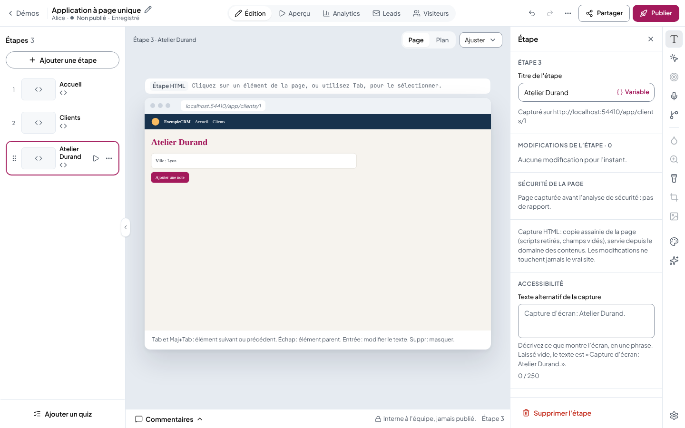
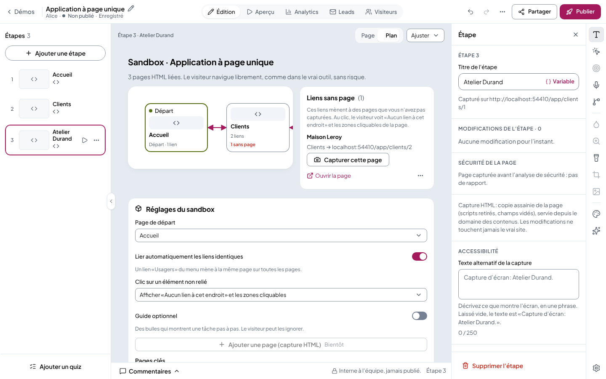
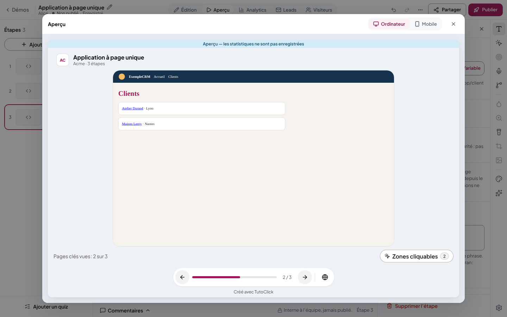
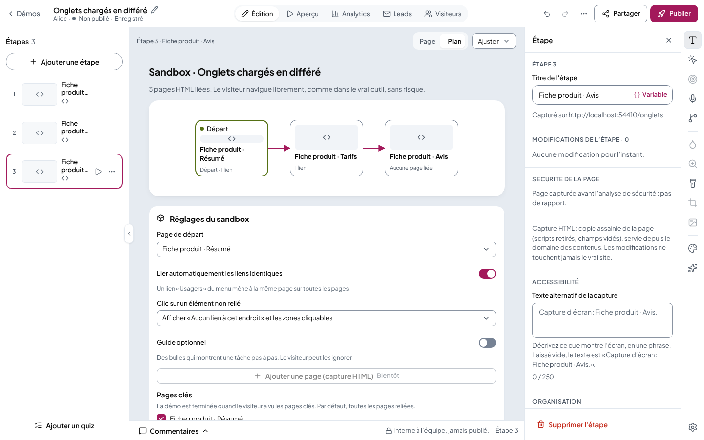
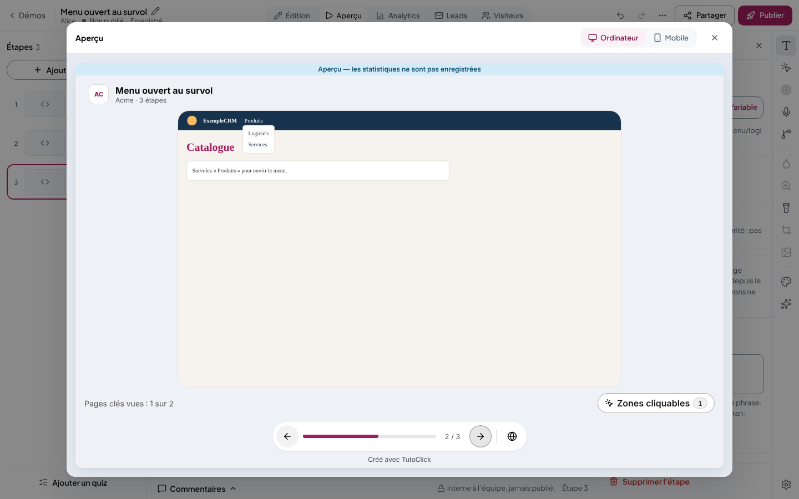
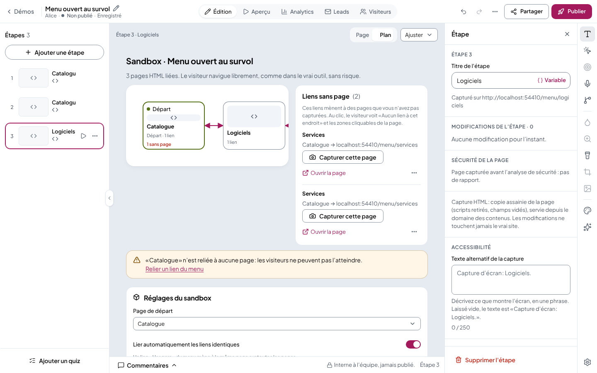
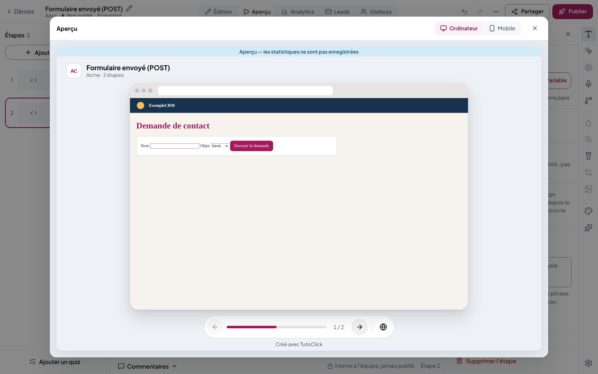
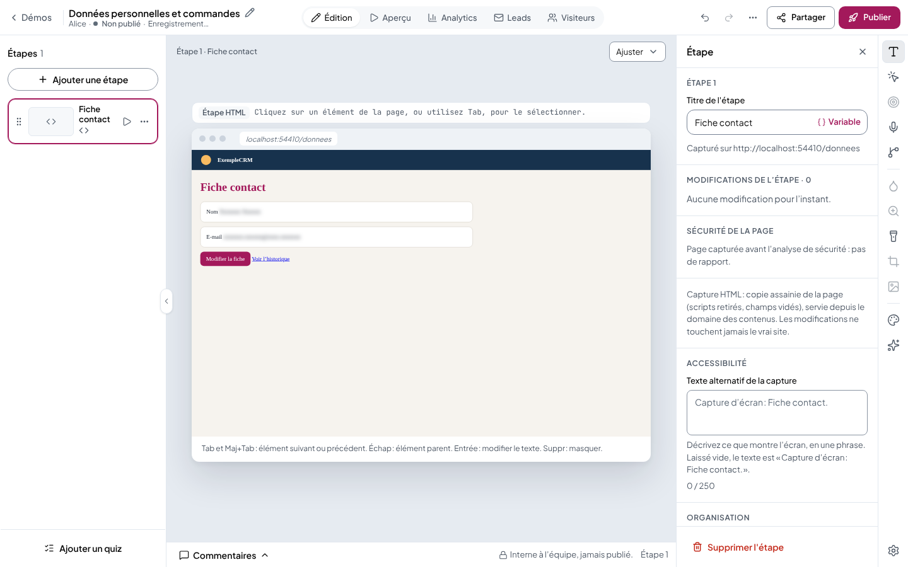

# L60 lot B : recette « à la place de l’utilisateur »

Ce que j’ai fait, pour de vrai : l’extension construite est chargée dans Chromium, je parcours
les sept sites fictifs du banc (`apps/extension/e2e/banc/`), j’envoie depuis « Vérifier avant
l’envoi », puis j’ouvre dans l’app ce que l’extension a envoyé, sans rien retoucher : éditeur,
plan du Sandbox, aperçu du lecteur. Le parcours est rejouable
(`node e2e/banc/bout-en-bout.cjs`) et tourne en intégration continue. Le détail des 111
contrôles est dans [controles.md](controles.md).

Limite connue : le faux serveur ne rejoue pas l’assainissement de `html-ingest` (testé à part).
Le panneau « Sécurité de la page » affiche donc « pas de rapport » sur les captures ci-dessous.

La vidéo (faux flux d’onglet) est couverte par `etat-video.cjs`, livré juste avant.

## Verdict

Chaque page ou clic capturé arrive dans l’outil, à son rang, sous le nom de l’écran, et la page
est rendue comme sur le site (couleurs, logo, mise en page). L’aperçu ouvre la première page et
passe à la suivante. Quatre points gênent un utilisateur ; ils sont listés plus bas et ne sont
pas corrigés dans ce lot, car ils touchent à la structure de l’app : à arbitrer par l’UX.

| Parcours | Type envoyé | Étapes | Noms | Rendu | Plan | Aperçu |
| --- | --- | --- | --- | --- | --- | --- |
| Application à page unique | Sandbox | 3 sur 3 | oui | oui | oui | oui, clic capturé |
| Formulaire envoyé (POST) | Démo guidée | 2 sur 2 | oui | oui | sans objet | oui, flèche |
| Scripts tiers | Démo guidée | 2 sur 2 | oui | oui | sans objet | oui, flèche |
| Onglets chargés en différé | Sandbox | 3 sur 3 | oui | oui | oui | oui, clic capturé |
| Menu ouvert au survol | Sandbox | 3 sur 3 | oui, mais doublon | oui | oui | oui, flèche |
| Données personnelles et commandes | Démo guidée | 1 sur 1 | oui | oui, données masquées | sans objet | oui |
| Page piège (libellés voisins) | Démo guidée | 1 sur 1 | oui | oui | sans objet | oui |

## Ce que voit l’utilisateur

### Application à page unique, en Sandbox

Trois écrans visités, trois étapes : « Accueil », « Clients », « Atelier Durand ». La fiche se
lit en entier, « Ville : Lyon » reste lisible.

Le plan relie les trois pages dans l’ordre du parcours et signale le seul lien jamais visité
(« Maison Leroy ») comme page non capturée.

Dans l’aperçu, un clic sur « Clients » mène à la liste, comme sur le site.

### Onglets chargés en différé, en Sandbox

Chaque onglet a son nom : « Fiche produit · Résumé », « · Tarifs », « · Avis ».

### Menu ouvert au survol, en Sandbox

Le menu capturé ouvert reste ouvert dans le lecteur.

### Formulaire et données personnelles

Le formulaire arrive vidé, la fiche contact arrive avec le nom et l’e-mail masqués.

## Ce qui gêne (à arbitrer, non corrigé ici)

1. **Deux étapes du même nom.** La page et son état « menu ouvert » s’appellent toutes deux
   « Catalogue ». Dans la liste et le plan, rien ne les distingue. Piste : nommer l’état
   d’après le menu ouvert (« Catalogue · Produits »).
2. **« Liens sans page » en double.** Le même lien « Services » est listé deux fois, une fois
   par page qui le porte, avec le même texte. Piste : une ligne par destination, avec le
   nombre de pages concernées.
3. **Noms tronqués dans la liste des étapes.** « Fiche produit… » trois fois de suite, et
   « Catalogu » coupé net sans points de suspension. Les onglets deviennent indiscernables
   dans la colonne de gauche, alors que le plan les affiche en entier.
4. **Barre d’adresse vide dans l’aperçu d’une démo guidée.** Le cadre de navigateur montre un
   champ blanc sans adresse ; en Sandbox, il n’y a pas de cadre du tout.

Rappel du lot A, toujours vrai : pour capturer un menu au survol, il faut penser à « Capturer
cette page » menu ouvert ; rien ne le suggère encore (lot C).
