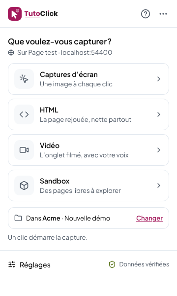
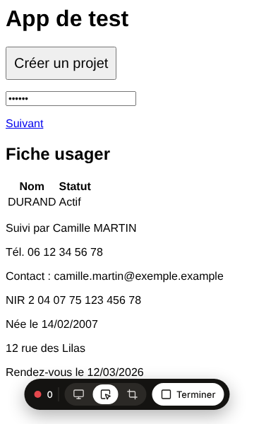
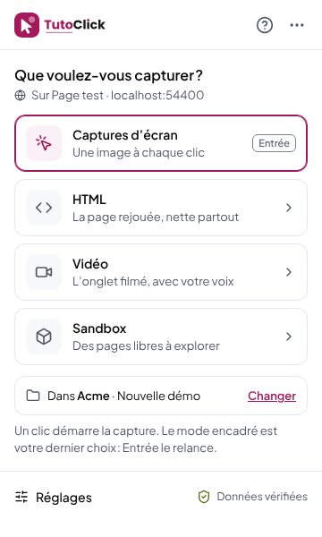
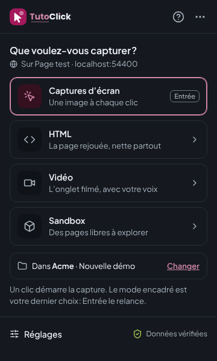
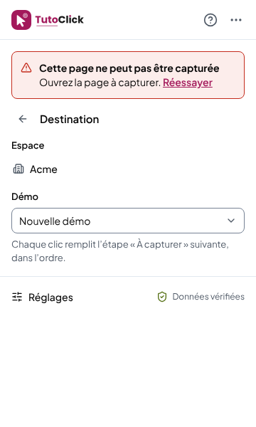
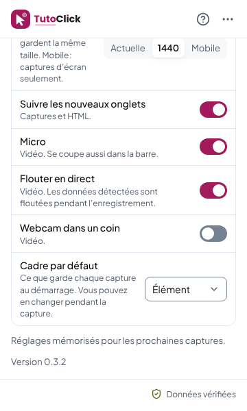
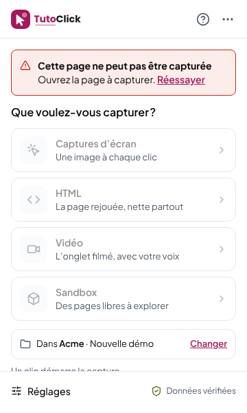
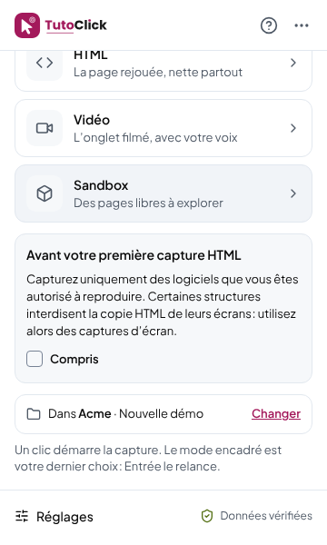

# L60 lot C, popup « Que voulez-vous capturer ? » : rapport « à la place de l’utilisateur »

Spécification : `docs/ux/specs/l60-capture-bout-en-bout.md` §1 (branche UX). Recette faite pour de vrai :
- l’extension est construite (`WXT_E2E=1 WXT_DEBUGGER=1`, puis la version de la boutique pour les
  autorisations) et chargée dans Chromium ;
- le popup est ouvert sur une page de test fictive, en clair et en sombre ;
- chaque mode est lancé d’un clic, et l’on vérifie que la capture démarre.

Parcours rejouable : `node e2e/popup.e2e.cjs` (68 contrôles, 34 par thème), plus `html`, `guided`, `tabs`,
`video`, `permissions` adaptés.

## 1. Deux gestes : ouvrir, choisir le mode

Plus de titre, de type, de « Démarrer ». Le popup demande « Que voulez-vous capturer ? » et rappelle la
page visée (« Sur Page test · localhost:54400 »). Un clic sur une ligne démarre ; la démo prend le titre
de l’onglet.

Après le clic sur « Captures d’écran », la barre de capture est sur la page, sans autre décision :

## 2. Dernier mode : encadré, Entrée le relance

À la réouverture, « Captures d’écran » est encadrée en couleur de marque (bordure et contour intérieur),
sa tuile est teintée, elle porte la touche « Entrée » et a le focus. Entrée relance la capture (vérifié).
Les flèches haut et bas passent d’un mode à l’autre.

 

## 3. Destination et Réglages

- « Dans **Acme** · Nouvelle démo », 44 px, avec « Changer » : la vue Destination donne l’espace et, s’il y
  en a, les démos à compléter (capture guidée). Après « Prise en main », la ligne dit « Dans Acme · Prise
  en main ».
- Réglages de capture, tous mémorisés : taille de l’onglet (Actuelle · 1440 · Mobile), nouveaux onglets,
  micro, flouter en direct, webcam, cadre par défaut. « Format mobile » n’est plus un type : c’est la
  taille Mobile (captures d’écran). Dans la version de la boutique, Mobile reste visible en « Bientôt ».

 

## 4. Jamais de popup vide

Page impossible à capturer : le bandeau d’erreur, et les 4 lignes restent, désactivées. Règle de l’espace
(L49) : HTML et Sandbox restent visibles, grisées, avec « Désactivé par l’espace » ou « Non autorisé sur
{domaine} » à la place de la phrase.

## 5. Avertissement HTML une seule fois

Au premier choix de HTML ou de Sandbox, la mention d’autorisation s’affiche dans le popup, avec une case
« Compris » ; rien ne démarre avant. « Compris » lance la capture, et la mention ne revient plus (Sandbox
ensuite démarre directement). Elle ne recouvre plus la page.

## 6. Écarts et points à trancher

1. **Hauteur.** Le popup suit son contenu (600 px au plus). Avec le bandeau d’erreur, la vue des modes
   atteint 600 px et le corps défile.
2. **Webcam et cadre par défaut** restent dans les Réglages (la spec cite quatre réglages ; ces deux-là
   existaient déjà).
3. **Taille 1440 et Mobile.** Mobile vaut pour les captures d’écran ; en HTML, la taille actuelle est
   gardée (aide « Mobile : captures d’écran seulement »). La taille personnalisée et l’orientation
   disparaissent du popup.
4. **« Page entière » en « Bientôt »** (version de la boutique) n’est plus affichée : la spec ne la
   reprend pas.
5. **Destination** : espace et démo à compléter seulement. L’arbre des dossiers et « Ajouter à une
   démo » viennent avec L64 §2.
6. **Vidéo** : le clic part bien vers l’enregistrement, mais un Chromium sans écran n’a pas de flux
   d’onglet. Le démarrage vidéo depuis le popup reste à vérifier sur un vrai poste.
