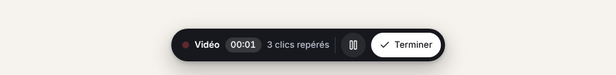
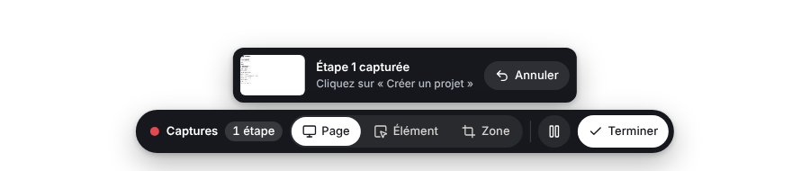
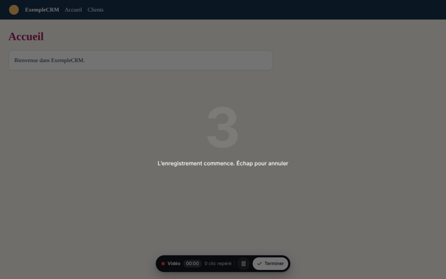

# L60 lot D, barre de capture commune : rapport « à la place de l’utilisateur »

Spécification : `docs/ux/specs/l60-capture-bout-en-bout.md` §2 (branche UX). Recette faite pour de vrai :
- extension construite (`WXT_E2E=1 WXT_DEBUGGER=1`) et chargée dans Chromium ;
- captures d’écran et HTML sur les pages de test fictives, puis sur les sites du banc ;
- vidéo sur le banc avec le faux flux d’onglet (`e2e/banc/etat-video.cjs`).

Parcours rejouables : `cadre`, `html`, `html-spa`, `guided`, `tabs`, `capture`, `ajout`, `video`, et le banc
(`etat-captures`, `etat-html`, `etat-video`). Tous verts.

## 1. Une seule barre, même forme dans les 4 modes

- Capsule de 48 px, à 20 px du bas, fond sombre fixe `#16181d`, ombre de menu.
- Contrôles de 36 px sur le même centre (mesuré dans les e2e).
- De gauche à droite : point, nom du mode, pastille ; partie propre au mode ; filet ; Pause ; Terminer
  (blanc, icône Check). Elle se déplace en la glissant, comme avant.

Captures d’écran : segmenté Page / Élément / Zone.

HTML : « Chaque clic devient une étape », puis « Ajouter cette page ». Sandbox : « Sandbox » et « Chaque
page visitée est ajoutée ».

Vidéo : chronomètre en pastille, « 3 clics repérés » (ils deviendront les pauses), bouton Micro
(`aria-pressed`) quand le micro est actif, Pause, Terminer.

## 2. Retour à chaque capture

Une carte apparaît 8 px au-dessus de la barre pendant 2 s :
- miniature de la capture (72 × 45 ; icône Code pour une page HTML) ;
- « Étape 1 capturée » et « Cliquez sur « Créer un projet » » ;
- « Annuler », qui retire l’étape (vérifié : 1 → 0 étape ; en HTML, 3 → 2 pages, puis la page reprise).

La carte reste affichée tant que la souris ou le focus est dessus. Elle est annoncée en `role="status"`.
Un anneau rouge marque le point cliqué pendant 400 ms, hors de l’image, et rien ne bouge en mouvement réduit.

## 3. Pause

- Point orange, « En pause », « Vos clics ne sont pas capturés » ; « Reprendre » remplace Pause.
- Un clic sur la page pendant la pause ne crée pas d’étape (vérifié en captures d’écran et en HTML : la
  page ouverte par le clic n’est pas ajoutée).
- Alt + Maj + P met en pause et reprend dans les 4 modes (raccourci de Chrome et de la page, une seule
  bascule par geste).

## 4. Vidéo : compte à rebours

Compte à rebours de 3 s en plein écran, fond assombri à 55 %, « L’enregistrement commence. Échap pour
annuler ». L’enregistrement démarre en pause et le temps du compte à rebours n’est pas compté. En
mouvement réduit, le chiffre change sans animation. Vérifié sur le banc avec le faux flux.

## 5. Écarts et points à trancher

1. **« Marquer une étape »** quitte la barre vidéo (la spec ne l’y met pas). Le raccourci Alt + Maj + M
   reste.
2. **Sandbox garde « Ajouter cette page »**. La spec dit « rien à faire de plus », mais une application à
   page unique a parfois besoin de l’ajout à la main.
3. **Puces de la barre** (« Onglet 2 · Aide », « Étape à capturer : … », cible d’un ajout) : elles restent,
   en gris, dans la partie du mode.
4. **Annuler** ne retire que la dernière étape (la carte n’existe que pour elle).
5. **Micro** : la piste est coupée sans arrêter l’enregistrement. Sans écran, le micro n’est pas testé :
   à vérifier sur un vrai poste, comme le démarrage vidéo depuis le popup.
