# L60 lot E et L64, Terminer et arrivée dans l’app : rapport « à la place de l’utilisateur »

Spécifications : `docs/ux/specs/l60-capture-bout-en-bout.md` §3 et L64 (branche UX). Recette faite pour de vrai :

- extension construite (`WXT_E2E=1 WXT_DEBUGGER=1`, `WXT_APP_URL` vers le faux serveur) et chargée dans Chromium ;
- faux Supabase (`e2e/mock-supabase.cjs`) avec un faux fournisseur d’IA : aucune donnée réelle, aucun appel réel ;
- éditeur web ouvert sur le faux Supabase de l’app (`apps/web/e2e/fake-supabase.cjs`).

Parcours rejouables, tous verts : extension `terminer`, `popup` (104), `redaction`, `capture`, `cadre`, `tabs`,
`html`, `html-spa`, `html-verification`, `guided`, `video`, `video-masque`, `video-revue`, `ajout`, `external`,
`permissions`, banc (`bout-en-bout` 150, `etat-captures`, `etat-html`, `etat-video`) ; web `arrivee-capture`
(clair et sombre), `capture-etapes`, `assistance-ia`, `variables`, `formation-outils`.

## 1. Terminer : envoi « n / total »

J’ai capturé deux étapes sur une page sans donnée personnelle, puis cliqué sur Terminer.

- Rien n’a été détecté : la vérification ne s’ouvre pas. La barre devient le panneau d’envoi « Envoi des
  étapes… 0 / 2 », avec la barre de progression et « La démo s’ouvre dans TutoClick dès que c’est prêt. Vous
  pouvez fermer cet onglet. ».
- Les clics sur la page ne capturent plus rien pendant l’envoi.
- Une donnée détectée (page de test fictive) : la vérification s’ouvre comme avant, l’envoi part de là.

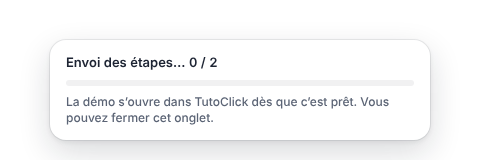

## 2. Arrivée dans l’éditeur

- L’éditeur s’ouvre dans l’onglet TutoClick déjà ouvert s’il y en a un, sinon dans un nouvel onglet.
- Toast « Démo prête : 3 étapes capturées » avec « Aperçu », qui ouvre l’aperçu.
- L’adresse perd `?ready=` : un rechargement ne rejoue pas le toast.
- Chaque étape porte l’étiquette verte « Nouvelle » jusqu’à sa première modification. Elle est gardée après un
  rechargement.

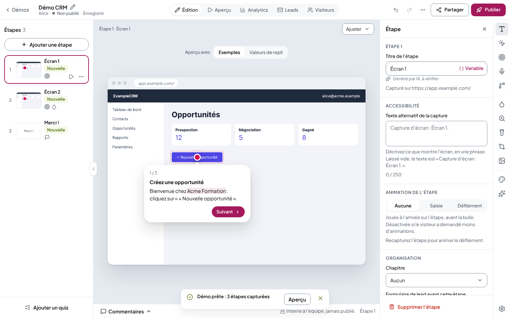

## 3. « En direct depuis l’extension »

Si la démo est déjà ouverte (« Capturer de nouvelles étapes »), un bandeau s’affiche : « En direct depuis
l’extension · 3 étapes reçues · Captures d’écran. », avec un repère « Étape 6 · réception… » à l’endroit
d’insertion.

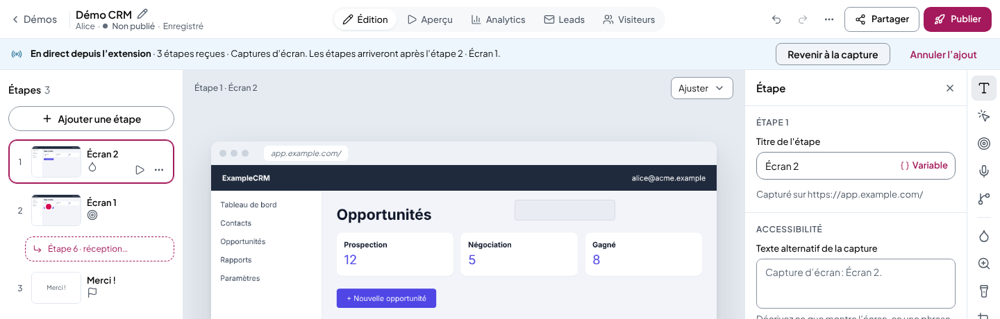

**Écart** : les étapes sont insérées à l’envoi, pas au fil des clics (le bandeau compte celles reçues).

## 4. Apparence : Système, Clair, Sombre (L64 §4)

Dans les Réglages, « Apparence » (Système par défaut) est mémorisée. Elle s’applique au popup, à la barre et
aux écrans de vérification, et suit un changement fait pendant qu’ils sont ouverts.

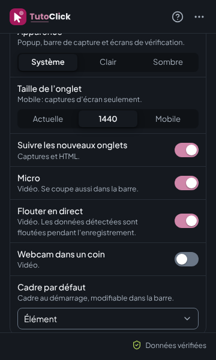

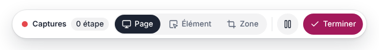

## 5. Menu ⋯ (L64 §1)

Le menu liste les espaces avec le nombre de membres et le rôle. Un espace où je suis lecteur est grisé
(« Lecteur : capture impossible »). Ensuite : Ouvrir TutoClick, Réglages de capture, Aide, et « Se déconnecter »
avec l’adresse. Pendant une capture, la déconnexion demande une confirmation.

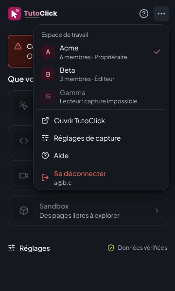

## 6. Destination : dossier ou démo existante (L64 §2)

- « Nouvelle démo » : arbre des dossiers avec leurs nombres de démos. Le dossier choisi est mémorisé et la démo
  y est créée (`folder_id` vérifié à l’envoi).
- « Ajouter à une démo » : recherche, puis « Créer une facture · Support · 7 étapes ». Les nouvelles étapes
  s’ajoutent à la fin, et l’éditeur s’ouvre sans toast.
- Le résumé de l’écran d’accueil dit où ira la capture (« Dans Acme · Ventes · Nouvelle démo »).

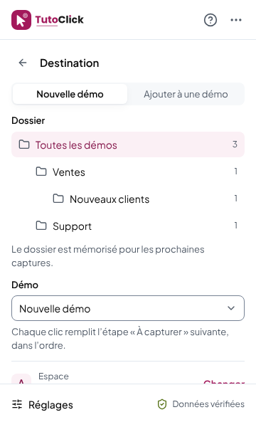

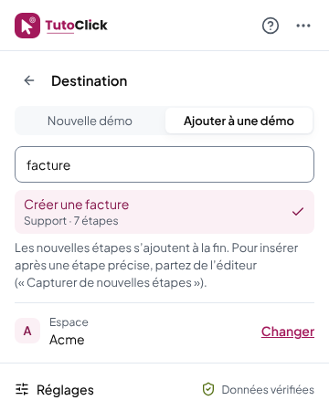

**Écart** : en vidéo, seule « Nouvelle démo » est proposée.

## 7. Rédaction automatique (L64 §3)

- Réglage en tête des Réglages, dans un encadré, désactivé par défaut et mémorisé. Si l’IA est coupée pour
  l’espace, l’encadré reste visible, l’interrupteur est désactivé et l’aide dit « Désactivé par l’espace ».
- Pendant la capture, la carte affiche « Rédaction… », puis « Texte proposé : « Cliquez sur « Nouveau projet »
  pour continuer. » » (2 lignes au plus). Si le fournisseur échoue, la ligne disparaît sans message.
- Seuls le libellé du clic et le titre de la page partent vers l’IA (corps de la requête vérifié, aucune image).
- À l’envoi, l’étape reçoit le titre et le texte proposés, avec le repère existant `aiText`. Dans l’éditeur,
  elle affiche le repère « IA » et « Généré par IA, à vérifier » sous le titre et sous le texte de la bulle,
  jusqu’à la première saisie.
- Aucun nom de fournisseur ni de modèle dans les textes de l’extension (vérifié par le test).

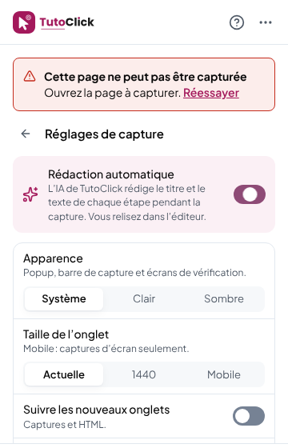

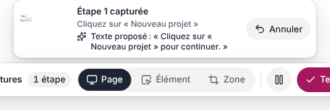

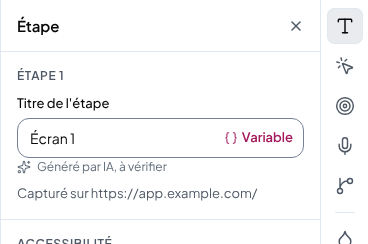

Correctif trouvé pendant la recette : l’ouverture du panneau d’une bulle retirait le repère « IA » (un
rechargement du champ comptait comme une saisie).

## Écarts et suites

- Étapes en direct : insérées à l’envoi, pas au fil des clics.
- Destination : pas d’ajout à une démo existante en vidéo.
- Rédaction automatique : un crédit IA par étape, consommé côté serveur. Sans réponse en 4 s, l’étape garde
  le libellé du clic.
